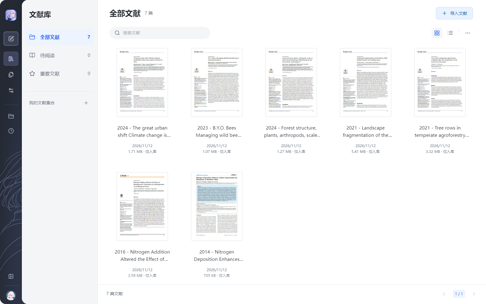
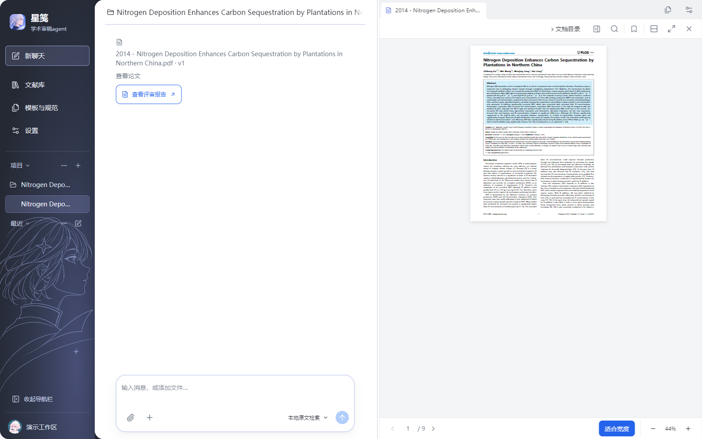
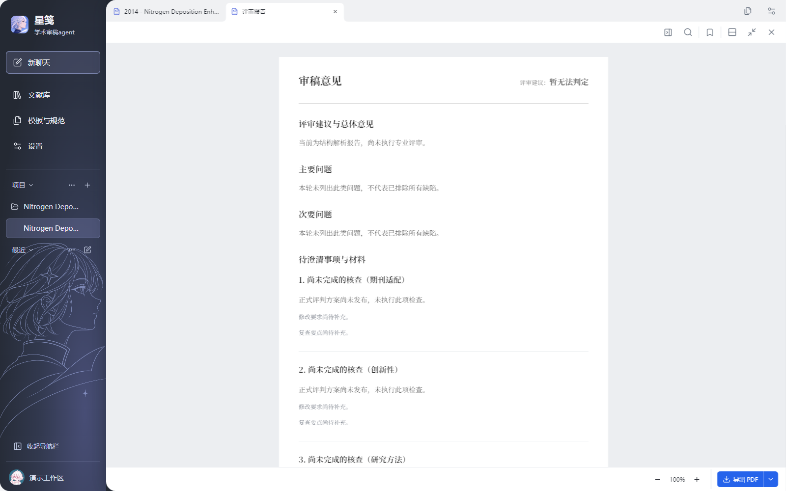
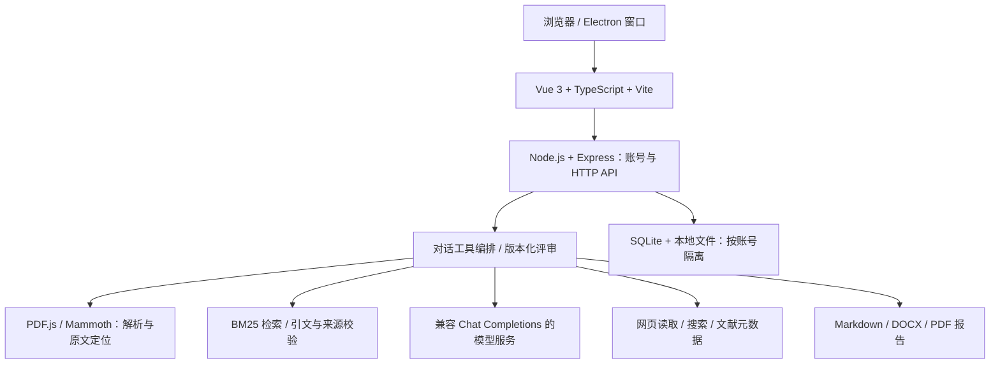

# 星笺 · 学术审稿 agent

星笺是一款面向不同学科的论文作者、研究者和审阅者的 AI 工作台。在同一个聊天里，可以上传 PDF 或 DOCX、说明评审方向、查看带原文位置的意见，再将报告导出给合作者。也可以从空白聊天开始整理资料，或把文献先存入文献库，之后再发起评审。系统支持修订稿复查，并已适配桌面和手机浏览器。



## 参赛材料

| 材料 | 入口与状态 |
| --- | --- |
| 代码仓库 | [GitHub 公开仓库](https://github.com/xzj828/paper-audit-copilot)，保留现有开发与协作历史。 |
| 技术文档 / 项目书 | 使用团队已有项目书，正式提交文件入口待补。本轮不重写项目书；仓库内的[历史技术说明](docs/technical-document.md)与[历史 PDF](docs/technical-document.pdf)保留作开发参考。 |
| 环境配置 | [变量说明与部署指南](docs/environment.md) · [环境变量模板](.env.example) · [依赖清单](package.json) · [依赖锁文件](package-lock.json)。 |
| 演示视频 | 待补最终视频链接；要求 5–8 分钟、MP4、不低于 1080p、普通话讲解。 |
| 提交检查 | [比赛要求与提交检查表](docs/competition.md)。官网提交、视频成片、团队信息及评审专用账号仍需最终确认。 |

## 在线体验与账号申请

星笺已部署至云服务器，可通过[在线演示入口](http://47.94.11.3:3001/)访问，支持电脑与手机浏览器。

**项目目前处于比赛阶段，在线体验账号需向开发者申请，由开发者统一开通和提供登录信息。**请联系[项目开发者](https://github.com/xzj828)申请账号，获得账号后登录使用。

以下本地启动步骤供自行部署使用；本地创建的账号不能用于登录上述在线演示服务。

## 本地快速启动

需要 **Node.js 24.12 或更新版本**，后端使用 Node.js 自带的 SQLite。首次运行时，先检出仓库并创建登录账号。

```sh
git clone https://github.com/xzj828/paper-audit-copilot.git
cd paper-audit-copilot
npm ci
cp .env.example .env
npm run account -- create sample-reviewer
npm run dev
```

Windows PowerShell 将复制命令替换为 `Copy-Item .env.example .env`。已有 `.env` 时保留原配置。默认配置可启动网页与本地文档功能；使用 AI 前需配置可用模型。

打开 [http://127.0.0.1:5173](http://127.0.0.1:5173)，使用刚创建的用户名和命令输出的随机密码登录。账号只需创建一次。全新数据库从空工作空间开始，密码请保存在本地。

开发模式由 Vite 在 5173 端口提供前端，API 默认监听 3001，Vite 代理 `/api`。前端支持热更新，后端默认需手动重启，以免编辑代码时打断评审。

## 完成一次论文评审

1. 推荐在 `.env` 设置 `MODEL_BASE_URL`、`MODEL_ID`、`MODEL_API_KEY`，执行 `npm run model:configure -- sample-reviewer` 为该账号导入并启用模型；如已在 **设置 → 模型服务** 配置好连接，无需重复导入。接口需兼容 Chat Completions，程序会在 Base URL 后追加 `/chat/completions`。登录后测试连接。如需 PDF 图表审查，选择支持 `image_url` 的模型并设置 `MODEL_VISION=true`，或在模型设置中启用图像输入。
2. 在侧栏创建聊天，从附件菜单上传论文，或在文献库选取已经导入的稿件。PDF 和 DOCX 单文件上限为 25 MB。可以用仓库附带的[公开论文样例](public/imports/ecology-seven-20261107/)试跑。
3. 通过附件菜单的 **评审文件** 发起评审，也可以直接在聊天里说明稿件和评审重点。
   > 请按通用论文标准评审这篇稿件，重点核查研究设计、统计方法和结论是否有原文证据，并给出可操作的修改建议。
4. 在聊天中查看进度，完成后点 **查看评审报告**。从报告和批注定位到原文，核对引文及上下文。正式报告可导出为 Markdown、DOCX 或 PDF。

评审可以引用 **模板与规范** 中的已有标准，也可以采用本次指定的通用标准、期刊要求或自定义关注点。需要按期刊指南评审时，可以附上指南文件或公开链接。报告记录本次评审依据和待核验项，分为评审建议与总体意见、主要问题、次要问题、待澄清事项与材料、评审范围与附录五部分。

### 论文预览与报告





*报告截图展示公开样例导入后生成的解析报告。*

## 工作台功能

星笺围绕原文核对和多轮修改组织评审过程。用户可在对话中说明关注点，结合通用标准或自定义规范发起评审，从报告和批注回到原文，再上传修订稿复查旧问题。手机端针对较窄屏幕调整导航、对话和文档阅读布局，方便用户查看论文与评审结果。

| 功能 | 可以做什么 |
| --- | --- |
| 聊天与项目 | 直接开启聊天，或在项目内建立多个聊天并共享文件。支持上传文件夹、管理目录、预览产出和恢复文本历史版本。 |
| 文献库 | 批量导入 PDF 和 DOCX，按集合、关键词或标记整理，预览和下载原稿。论文导入后可按需进入对话评审。 |
| 原文与批注 | 阅读 PDF 原页和 DOCX 结构预览，从引文、搜索结果或批注跳转到原文。可上传修订稿，查看版本差异和复核旧问题。 |
| 评审规则与报告 | 编辑可复用的评审标准，查看评审进度和报告快照。报告记录证据、问题影响、修改要求和复查要点。 |
| 联网与证据工具 | 聊天可按需读取公开网页、搜索网页和查询文献元数据。工作台另有 DOI 核验、主张与证据核对、CSV 描述统计等工具。 |
| 移动端适配 | 支持手机浏览器访问，针对窄屏调整导航、对话与论文阅读布局，便于查看原文、批注和报告。 |

网页搜索可使用已启用的官方 DeepSeek 连接，也可在联网设置配置 Brave Search。公开链接的正文、搜索摘要和文献元数据会按实际读取范围使用。详见[工作区与联网说明](docs/research-workspace.md#联网)。

## 运行与数据

生产模式使用 Node.js 同时提供构建后的网页和 API。

```sh
npm run build
npm start
```

打开 [http://127.0.0.1:3001](http://127.0.0.1:3001)。`npm start`、`npm run dev`、`npm run account` 和 `npm run model:configure` 会读取根目录 `.env`，已有进程环境变量优先。默认数据目录为 `./data`；创建账号、导入模型与启动服务必须使用相同的 `DATA_DIR`。直接执行 `node server/index.js` 时仍需自行传入 `--env-file` 或注入变量。

本地默认 `HOST=127.0.0.1`、`PORT=3001`。HTTPS 反向代理部署还需设置真实 `PUBLIC_ORIGIN`；HTTP IP 演示应保持该项未设置。`BRAVE_SEARCH_API_KEY`、`CHROME_PATH` 按需配置。已有模型连接不要求补填模型环境变量；新部署使用环境变量导入即可。详见[全部变量、加载顺序与密钥轮换](docs/environment.md)。

论文、报告、数据库和加密后的模型设置保存在运行机器上，按账号隔离。模型评审或对话会将任务所需的文本发送到所选模型服务，图表评审还可能发送 PDF 页面或裁剪区域。使用未公开稿件前，请确认稿件授权及服务商的数据政策。备份需覆盖数据目录、原始文件和模型加密主密钥，具体方法见[账号与部署](docs/accounts.md)。

Windows x64 用户可以直接下载 [v0.3.0 安装包](https://github.com/xzj828/paper-audit-copilot/releases/tag/v0.3.0)，首次启动在应用内创建本机账号；升级用户可选择接续旧工作空间。也可通过 `npm run desktop:start` 启动 Electron 桌面版，或用 `npm run desktop:make` 自行构建。桌面版使用自己的用户数据目录，构建、校验与备份方式见[桌面版说明](docs/desktop-release.md)。

## 使用边界

- 扫描件需先进行 OCR。复杂版式、公式、表格和图表应结合原稿核对。PDF 导出需要 Windows Chrome 或其他平台的 Playwright Chromium。
- 报告会区分已有依据的问题、尚待确认的疑问和缺失材料。引文匹配、模型复核和固定案例测试用于核对软件流程，论文的学术判断仍需人工审阅。

## 开发与验证

### 技术架构



### AI 方案与创新

- **选型与集成**：通过统一 Chat Completions 接口接入文本或视觉模型；对话模型生成结构化工具操作，服务端校验参数、范围和执行结果。模型选择由部署者根据能力、成本和延迟决定，不绑定单一服务商。
- **优化策略**：按任务读取文件、分块检索与有限上下文，结合分项评审、结构化结果校验、原文引文匹配和可恢复任务，减少无关输入并保留无法判断的原因。兼容问答采用 BM25 词法检索，不宣称使用向量数据库。
- **技术创新**：把评审问题与具体原文、版本、当次规则及报告快照关联；模型提出意见后仍需服务端核对来源。
- **应用创新**：把文献管理、对话指定评审方向、原文批注、报告交付和修订复查组织到同一个工作台。未开展独立专家准确率评测，不以自动测试通过率替代学术判断质量。

### 检查命令

```sh
npm run build                       # TypeScript 检查与生产构建
npm test                            # 单元和 HTTP API 测试
npm run test:e2e                    # Playwright 浏览器测试
npm run evaluate:pdf-suite          # 对固定出版商 PDF 样例复查
npm run evaluate:review-contracts   # 运行受控评审与证据校验用例
node --test tests/model-environment.test.js  # 环境导入、账号隔离和密钥更新
```

Windows 默认使用本机 Chrome，可用 `CHROME_PATH` 指定路径。其他平台先运行 `npx playwright install chromium`。离线缓存的目录边界测试需要系统允许创建符号链接。

| 目录 | 实现 |
| --- | --- |
| `src/` | Vue 3、TypeScript 和 Vite。包含账号登录、项目侧栏、聊天、文献库、论文预览和报告。 |
| `server/` | Node.js、Express 和 SQLite。包含账号隔离、文档解析、全文检索、模型调用、评审任务和报告导出。 |
| `desktop/` | Electron 启动入口和桌面数据目录配置。 |
| `tests/`、`scripts/` | 单元测试、浏览器测试、评测脚本和本机账号管理。 |

## 项目资料

- [文档解析与原文定位](docs/document-parsing.md)
- [PDF 样例复查](docs/pdf-suite.md)和[评审规则验证](docs/review-contracts.md)
- [比赛提交检查表](docs/competition.md)、[历史技术说明](docs/technical-document.md)和[历史技术 PDF](docs/technical-document.pdf)（最终参赛文档使用团队已有项目书）
- [环境配置](docs/environment.md)、[账号与部署](docs/accounts.md)

## 团队信息

已提供的成员与指导教师信息整理如下，其余信息暂留占位。正式提交前需与大赛报名信息一致，GitHub 贡献记录不替代参赛成员登记。

| 项目 | 信息 |
| --- | --- |
| 团队名称 | 三区兄弟 |
| 参赛学校 | 北京林业大学 |
| 指导教师 | 李琦，博士，北京林业大学信息学院讲师。 |
| 队长 | 【待填写姓名及职责】 |
| 团队成员与分工 | 肖自杰：产品与交互设计、前端与 UI 实现、模型 API 接入、前后端联调及全栈功能开发。杨智轶：技术文档撰写与整理、演示视频录制、Git 版本控制与代码仓库管理。其他成员【待补充】。 |
| 联系方式 | [GitHub 项目维护者](https://github.com/xzj828)；赛事联系方式在报名系统提供。 |

### 指导教师：李琦

博士，北京林业大学信息学院讲师。主要研究方向为机器学习、人工智能、聚类分析与软件工程，主讲《算法设计与分析》《程序设计基础》等课程。

- **科研项目**：主持工业和信息化部“算力强基”揭榜行动课题、中国科学院科研课题、三峡集团联合科研课题等 8 项，年度科研经费超过 100 万元。
- **学术成果**：在 *Pattern Recognition*、*IEEE TKDE*、*ICDE*、*KDD* 等期刊与会议发表学术论文 20 余篇，成果涵盖 SCI 一区及 CCF A 类期刊、会议。
- **科研获奖**：获中国指挥与控制学会 2023 年度科学技术奖“科技进步奖”一等奖及优秀论文奖等奖励。

### 团队成员：肖自杰


北京林业大学人工智能专业。负责产品需求梳理与交互方案设计、前端界面与 UI 实现、模型 API 接入及前后端联调，参与系统全栈功能开发与使用体验优化。

- **竞赛获奖**：中国大学生计算机设计大赛北京市二等奖；北京林业大学勉励杯优秀奖。
- **奖学金**：优秀学生奖学金三等奖、体育单项奖学金。
- **实习经历**：在北京笔记侠有限公司、浙江西鸣科技有限公司相关实习中，参与企业运营智能体、自动化批量生图工具、人事系统及拼多多平台投流工具开发。
- **项目经历**：参与生物多样性大学生创新项目，负责监测系统前端开发；参与多智能体协同求职系统的全栈开发。

### 团队成员：杨智轶


北京林业大学网络工程专业。负责项目技术文档撰写与整理、功能演示视频录制，以及 Git 版本控制与代码仓库管理。

- **竞赛获奖**：全国大学生数学建模竞赛省级二等奖。

项目维护在 [xzj828/paper-audit-copilot](https://github.com/xzj828/paper-audit-copilot)，包含来自 [wilsonwuww/paper-audit-copilot](https://github.com/wilsonwuww/paper-audit-copilot) 的开发贡献，作者署名见提交历史。
