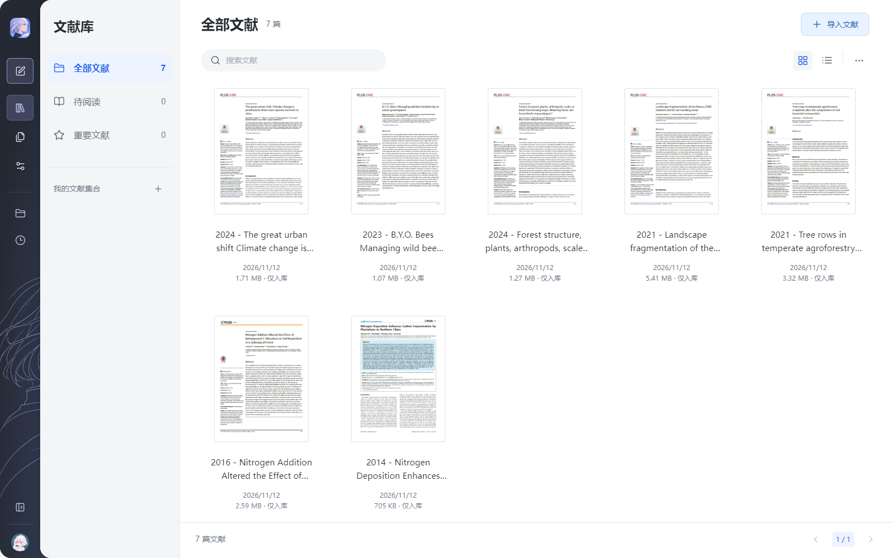
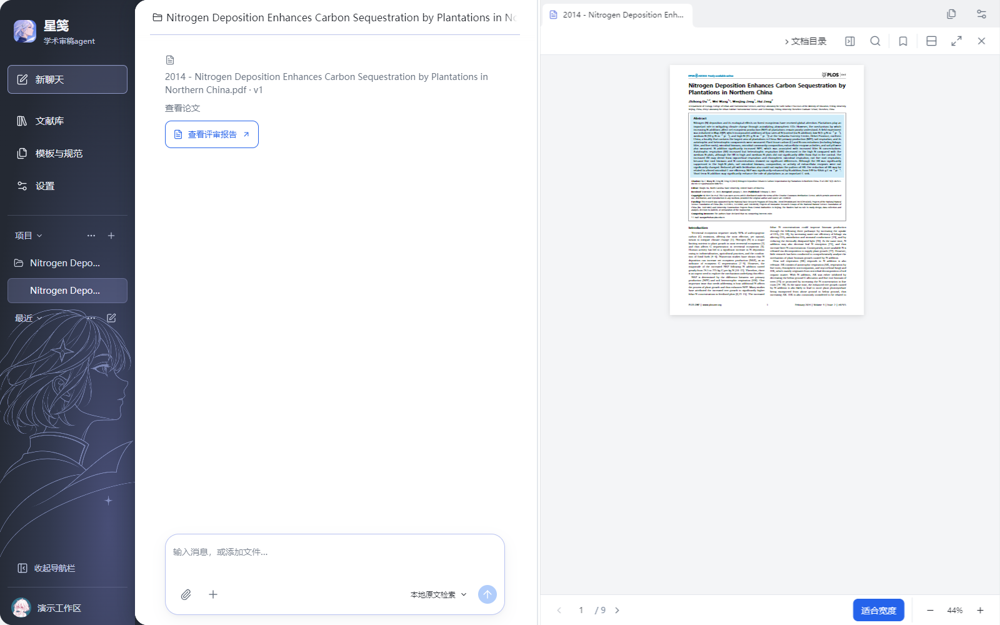
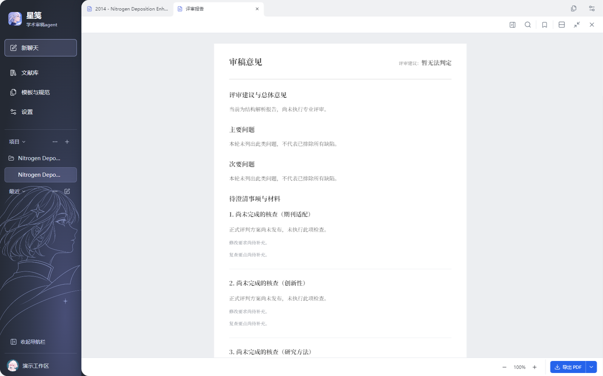

# 星笺 · 学术审稿 Copilot

星笺是一款面向论文作者、研究者和审阅者的 AI 工作台。在同一个聊天里，可以上传 PDF 或 DOCX、说明评审方向、查看带原文位置的意见，再将报告导出给合作者。也可以从空白聊天开始整理资料，或把文献先存入文献库，之后再发起评审。



## 快速启动

需要 **Node.js 24.12 或更新版本**，后端使用 Node.js 自带的 SQLite。首次运行时，先检出仓库并创建登录账号。

```sh
git clone https://github.com/xzj828/paper-audit-copilot.git
cd paper-audit-copilot
npm ci
npm run account -- create sample-reviewer
npm run dev
```

打开 [http://127.0.0.1:5173](http://127.0.0.1:5173)，使用刚创建的用户名和命令输出的随机密码登录。账号只需创建一次。全新数据库从空工作空间开始，密码请保存在本地。

开发模式由 Vite 在 5173 端口提供前端，API 默认监听 3001，Vite 代理 `/api`。前端支持热更新，后端默认需手动重启，以免编辑代码时打断评审。

## 完成一次论文评审

1. 在 **设置 → 模型服务** 添加连接，填写服务商提供的 API Base URL、模型 ID 和 API Key。测试连接后保存并启用。接口需兼容 Chat Completions，程序会在 Base URL 后追加 `/chat/completions`。如需 PDF 图表审查，选择支持 `image_url` 的模型并启用图像输入。
2. 在侧栏创建聊天，从附件菜单上传论文，或在文献库选取已经导入的稿件。PDF 和 DOCX 单文件上限为 25 MB。可以用仓库附带的[公开论文样例](public/imports/ecology-seven-20261107/)试跑。
3. 通过附件菜单的 **评审文件** 发起评审，也可以直接在聊天里说明稿件和评审重点。
   > 请按通用论文标准评审这篇稿件，重点核查研究设计、统计方法和结论是否有原文证据，并给出可操作的修改建议。
4. 在聊天中查看进度，完成后点 **查看评审报告**。从报告和批注定位到原文，核对引文及上下文。正式报告可导出为 Markdown、DOCX 或 PDF。

评审可以引用 **模板与规范** 中的已有标准，也可以采用本次指定的通用标准、期刊要求或自定义关注点。需要按期刊指南评审时，可以附上指南文件或公开链接。报告记录本次评审依据和待核验项，分为评审建议与总体意见、主要问题、次要问题、待澄清事项与材料、评审范围与附录五部分。

### 论文预览与报告





*报告截图展示公开样例导入后生成的解析报告。*

## 工作台功能

| 功能 | 可以做什么 |
| --- | --- |
| 聊天与项目 | 直接开启聊天，或在项目内建立多个聊天并共享文件。支持上传文件夹、管理目录、预览产出和恢复文本历史版本。 |
| 文献库 | 批量导入 PDF 和 DOCX，按集合、关键词或标记整理，预览和下载原稿。论文导入后可按需进入对话评审。 |
| 原文与批注 | 阅读 PDF 原页和 DOCX 结构预览，从引文、搜索结果或批注跳转到原文。可上传修订稿，查看版本差异和复核旧问题。 |
| 评审规则与报告 | 编辑可复用的评审标准，查看评审进度和报告快照。报告记录证据、问题影响、修改要求和复查要点。 |
| 联网与证据工具 | 聊天可按需读取公开网页、搜索网页和查询文献元数据。工作台另有 DOI 核验、主张与证据核对、CSV 描述统计等工具。 |

网页搜索可使用已启用的官方 DeepSeek 连接，也可在联网设置配置 Brave Search。公开链接的正文、搜索摘要和文献元数据会按实际读取范围使用。详见[工作区与联网说明](docs/research-workspace.md#联网)。

## 运行与数据

生产模式使用 Node.js 同时提供构建后的网页和 API。

```sh
npm run build
npm start
```

打开 [http://127.0.0.1:3001](http://127.0.0.1:3001)。`HOST`、`PORT` 和 `DATA_DIR` 可通过进程环境变量设置，示例见 [`.env.example`](.env.example)。应用默认使用 `./data`，`npm start` 不会自动读取 `.env`；需要加载时可运行 `node --env-file=.env server/index.js`。创建账号时请使用与服务相同的 `DATA_DIR`。

论文、报告、数据库和加密后的模型设置保存在运行机器上，按账号隔离。模型评审或对话会将任务所需的文本发送到所选模型服务，图表评审还可能发送 PDF 页面或裁剪区域。使用未公开稿件前，请确认稿件授权及服务商的数据政策。备份需覆盖数据目录、原始文件和模型加密主密钥，具体方法见[账号与部署](docs/accounts.md)。

Windows x64 可通过 `npm run desktop:start` 启动 Electron 桌面版，或用 `npm run desktop:make` 构建安装包。桌面版使用自己的用户数据目录，构建与备份方式见[桌面版说明](docs/desktop-release.md)。

## 使用边界

- 扫描件需先进行 OCR。复杂版式、公式、表格和图表应结合原稿核对。PDF 导出需要 Windows Chrome 或其他平台的 Playwright Chromium。
- 报告会区分已有依据的问题、尚待确认的疑问和缺失材料。引文匹配、模型复核和固定案例测试用于核对软件流程，论文的学术判断仍需人工审阅。

## 开发与验证

```sh
npm run build                       # TypeScript 检查与生产构建
npm test                            # 单元和 HTTP API 测试
npm run test:e2e                    # Playwright 浏览器测试
npm run evaluate:pdf-suite          # 对固定出版商 PDF 样例复查
npm run evaluate:review-contracts   # 运行受控评审与证据校验用例
```

Windows 默认使用本机 Chrome，可用 `CHROME_PATH` 指定路径。其他平台先运行 `npx playwright install chromium`。离线缓存的目录边界测试需要系统允许创建符号链接。

| 目录 | 实现 |
| --- | --- |
| `src/` | Vue 3、TypeScript 和 Vite。包含账号登录、项目侧栏、聊天、文献库、论文预览和报告。 |
| `server/` | Node.js、Express 和 SQLite。包含账号隔离、文档解析、全文检索、模型调用、评审任务和报告导出。 |
| `desktop/` | Electron 启动入口和桌面数据目录配置。 |
| `tests/`、`scripts/` | 单元测试、浏览器测试、评测脚本和本机账号管理。 |

## 项目资料

- [文档解析与原文定位](docs/document-parsing.md)
- [PDF 样例复查](docs/pdf-suite.md)和[评审规则验证](docs/review-contracts.md)
- [第九届传智杯 AI WEB 参赛说明](docs/competition.md)、[技术文档](docs/technical-document.md)和[演示脚本](docs/demo-script.md)

项目维护在 [xzj828/paper-audit-copilot](https://github.com/xzj828/paper-audit-copilot)，包含来自 [wilsonwuww/paper-audit-copilot](https://github.com/wilsonwuww/paper-audit-copilot) 的开发贡献，作者署名见提交历史。
