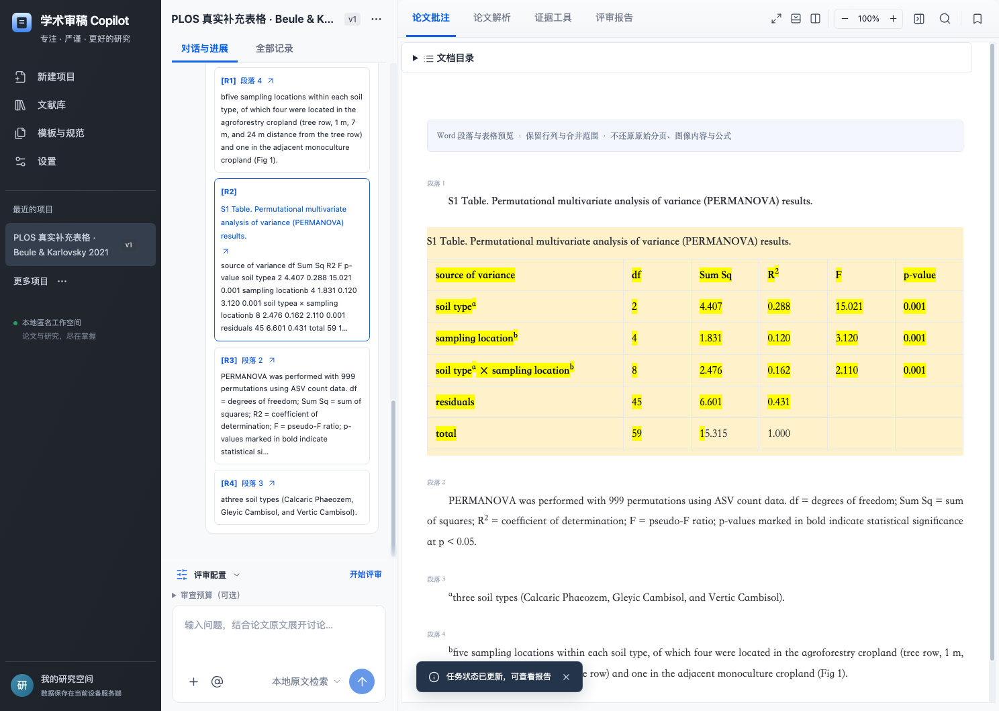
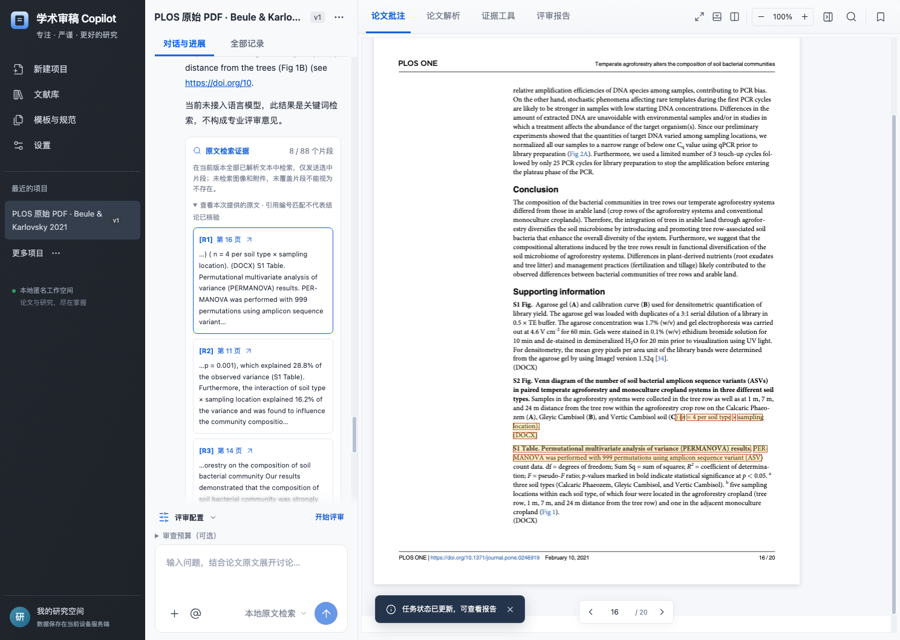

# 文档解析与证据定位

新上传的 DOCX 会保留表格行列、横向与纵向合并、原文中已有的加粗、斜体、上标和下标。表格作为一个独立文本区块参加全文检索；点击来源卡片，会按已保存的字符偏移高亮对应单元格并收起批注面板，聚焦原文。手机端没有批注时不弹出遮挡原文的空面板；表格放在可用键盘聚焦的横向滚动区域内。

## 使用

1. 新建项目，上传 DOCX。在“论文解析”查看表格、行、单元格和合并单元格数量及覆盖提醒。
2. 在“论文批注”阅读表格；输入原文中的术语提问，点击回答下方的检索证据。引文跨单元格时分别高亮实际文字。
3. 刷新后可继续阅读已保存的表格与来源。项目菜单的对话 JSON 导出包含全文引文、摘要偏移、解析器版本和文本规范化方式。

已有项目的历史解析与报告保持原快照，不自动重写；旧版没有表格结构的解析仍按段落显示。需要用新解析器重新读取同一文件时，可在新项目上传原文件；同项目相同文件指纹仍按原逻辑去重。

## 文本与位置契约

- DOCX 解析器标识为 `mammoth@1:structured-tables@1`，结构版本 `1.1.0`；新增 PDF 位置映射同样登记为 `1.1.0`，已有解析快照保持原值。
- 每个表格有稳定区块 ID，例如 `table-1`。单元格保存文字、区块内字符偏移、逻辑列位置、合并跨度，以及原文已明确标记的表头属性。
- 解析表格文本按实际单元格顺序，用 TAB 连接单元格、LF 连接行；单元格内部保留换行。空单元格保留，合并单元格的文字只出现一次，不补写隐含值。字符位置基于 JavaScript UTF-16 的解析文本，不是 DOCX ZIP 字节或 Word 页码。
- 格式运行保存相对于本段／单元格的偏移，不向原文插入上标符号或人工表头。原文仅加粗而未标记为表头时，保留加粗，不擅自推断其角色。
- 来源卡片的摘要有独立 `focusOffset`；不能把整个检索片段的起点误用为摘要起点。同一数字重复出现时，使用明确偏移定位。偏移与引文不匹配则拒绝错误高亮；旧消息仅在片段内摘要唯一时推导位置，重复且缺少 `focusOffset` 时保留完整已核验片段。
- DOCX 点击来源后显示引文定位状态。缺少位置且原段落出现多次时提示歧义，不高亮第一处；错位置或失配明确显示无法高亮。`exact-occurrence@2` 在服务器和阅读器使用相同的逐字范围约束，历史记录不自动补猜位置。

Mammoth 的 HTML 中间结果仅在后端转为文本和有限格式字段，不直接渲染进页面。嵌入样式映射与外部文件访问关闭；图像转换不读取图像字节，也不把图像替代文字当成 OCR 证据。

## 覆盖边界

不还原 Word 分页、原始边框、颜色、浮动对象、完整公式与图像正文。上下标文字保留可见格式，不能据此宣称数学公式已正确解释。嵌套表格的内部文字展平至所属单元格，并明确提示内部行列未还原。PDF 的双栏顺序、跨页表格和 OCR 仍是后续工作，当前 DOCX 改进不等于这些能力已经完成。

保留行列结构的表格限制为 20,000 文档区块、每表 5,000 行、256 逻辑列、每文档 50,000 个可视单元格；已展平的嵌套文本仍受中间结果的体积、节点与深度限制。无法确认的重叠合并或越界结构返回明确解析失败，原始上传文件保留。解析 Worker 的内存与时间限制继续生效。

## 真实来源与验证

固定公开材料为 Beule 与 Karlovsky（2021）在 PLOS ONE 发表论文的 **S1 Table 原始 DOCX**，不是把 XML 重新生成的 Word。文件未改动，CC BY 4.0；[来源、署名、许可与原文件指纹](../tests/fixtures/published-docx/README.md)均保留。原始 OOXML 单元格独立读取后登记了 6 行 × 6 列和三个查询，预期由开发者制定，不是领域专家金标准。

运行：

```sh
npm run evaluate:docx
npm run evaluate:docx -- --output /tmp/paper-audit-docx-results
node --test tests/parser-structure.test.js tests/text-highlight.test.js tests/chat-export.test.js
npx playwright test tests/e2e/document-structure.spec.js
```

固定案例本次为 36/36 单元格文字与偏移有效、3/3 查询召回预期行、10/10 返回引文及摘要位置有效。记录见 [JSON](docx-validation-results.json) 与 [Markdown](docx-validation-results.md)。命令默认只检查仓库中的固定样例，不联网、不调用模型；显式 `--output` 才保存报告。它使用生产解析 Worker，实际上传、点击、刷新与手机流程另外由浏览器测试验证。

控制样例另覆盖合并单元格、嵌套表格、不可读图像、嵌入样式映射、超宽表格拒绝、重复数字与跨单元格引文。检索召回与原文有效不证明统计方法正确，不代表模型结论支持度或专家审稿准确率。



## PDF 原文偏移与文字块定位

v10 的新解析标识为 `pdfjs-dist@6:text-map@1:diagnostics@1`，另保存 `pdf-extraction-diagnostics@1`。逐页体检展示文字稀少、无文字和坐标缺口；可筛选、跳转原页及下载带文件和解析身份的 JSON。新报告冻结同一快照并独立导出。旧解析不自动补造体检，文字、阅读顺序和偏移均保持原样；详见 [逐页体检的阈值、实际验证与边界](pdf-inspection.md)。

新 PDF 解析器标识为 `pdfjs-dist@6:text-map@1`，每个物理页保存 `pdf-text-map@1`。保持 PDF.js 返回的内嵌文字顺序：文字块后按原有 EOL 标志添加 LF，否则添加 SPACE，再去除整页两端空白。每块记录其在这份解析文本中的 UTF-16 起止偏移、逐字文字和页面视口中的归一化矩形；文本不为定位另行重排或改写。

点击引文先检查页号、区块 ID 和明确偏移处的逐字文本，再检查文字块偏移、引用覆盖和矩形。同页两处相同文字按保存偏移区分；跨行引用显示多个文字块框。文字框覆盖整个 PDF.js 文字块，可能包含相邻字，不宣称逐字形框的精度。使用包含旋转与 CropBox 的页面视口、文字变换与字体度量，缩放时用比例映射到实际渲染的页面。页面渲染完成前不显示位置框，也不声称已经定位。

只要引文失配或覆盖坐标不完整，本次就不显示位置框。旧解析无文字映射时跳转物理页并提示坐标不可用；旧引用没有明确偏移且出现多次时提示歧义，不猜第一处。旧快照不自动重解析。手动原文搜索以实际字符匹配建立偏移，点击搜索结果会定位实际命中，不能把页面前 100 字当成搜索证据。

手机端恢复缩小、重置和放大；原页可在预览区域内滚动。连续阅读的后续页面按纵向排列。竖排文字、不可见或越过裁剪区域的文字、退化坐标不获得误导性位置框。每页上限 50,000 文字块、1,000,000 字符，解析 Worker 的时间、内存和上传体积限制仍生效。

当前保持内嵌文字顺序，不重建双栏阅读顺序、跨页表格关系、图像正文或完整公式，不执行 OCR。解析界面仍提示这些覆盖缺口；坐标可映射不能证明列间顺序或科学支持关系正确。

### 原始 PDF 与复现

使用 Beule 与 Karlovsky（2021）的未修改出版商原始 PDF，共 20 物理页。许可、作者、原始图像署名、DOI、文件 SHA-256 和固定查询见[材料说明](../tests/fixtures/published-pdf/README.md)。三个查询在运行检索前，用独立 pypdf 提取和原文件第 4、7、16 页渲染核对短语与物理页。预期由开发者制定，不是专家金标准。

```sh
npm run evaluate:pdf
npm run evaluate:pdf -- --output /tmp/paper-audit-pdf-results
node --test tests/pdf-text.test.js tests/published-pdf.test.js tests/text-highlight.test.js tests/chat-export.test.js
npx playwright test tests/e2e/pdf-evidence.spec.js
```

实际固定查询为 3/3 召回、3/3 预期短语可映射；21/21 返回切片及摘要逐字有效，21/21 完整切片与摘要可映射，非空白文字块坐标缺口为 0。记录见 [JSON](pdf-validation-results.json) 与 [Markdown](pdf-validation-results.md)。这是一份文件的固定开发检查，不是通用解析成功率、字形坐标准确率或专家审稿准确率。报告保存实现与源文件哈希、全部分母和逐项状态；命令不联网、不调用模型。

浏览器另外实际上传原始文件，查询后部补充材料并点击第 16 页证据，检查刷新后的来源；受控保存记录验证第二处重复引文、旧歧义、错误偏移与坐标缺口，旋转裁剪控制样例验证手机缩放与原始基线坐标。控制回放与真实问答分开登记。

2026-10-08 统一引文校验后再次离线运行同一原始 PDF 与预设查询：3/3 召回，21/21 完整引文及摘要逐字有效并可映射。报告新增共享逐字范围模块的实现哈希；原文件、许可与预期不变。浏览器另验证实际上传的合成 PDF 经本机 HTTP 关系判断保留第二处位置，不以旧控制记录代替传输验证。

计算依据：[PDF.js 页面视口示例](https://mozilla.github.io/pdf.js/examples/)与[官方文字层实现](https://github.com/mozilla/pdf.js/blob/master/src/display/text_layer.js)。实际运行依赖以锁文件为准，不能用文档中上游最新代码代替本地已安装版本验证。


