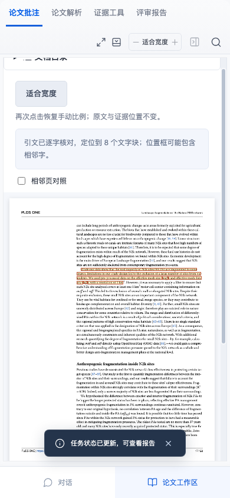

# 第四篇真实原始PDF：保护区景观破碎化

Lawrence, A., Friedrich, F. & Beierkuhnlein, C. (2021), _Landscape fragmentation of the Natura 2000 network and its surrounding areas_, PLOS ONE 16(10): e0258615。[出版商原文与版权](https://journals.plos.org/plosone/article?id=10.1371/journal.pone.0258615)。本轮2026-10-29读取出版商版权行与原PDF第一页，跟随许可链接核对[CC BY4.0](https://creativecommons.org/licenses/by/4.0/)。保留所有原作者、图像与原署名，PDF未改动；再次分发应保留fixtures说明和来源/许可，不暗示原作者支持本产品。

原PDF路径tests/fixtures/published-pdf/lawrence-2021.pdf，5673407字节、22物理页，SHA-256为4318e4cec86d46fb1540627d4fcd3ad9639c620d7420ce625602a11e18f72cfa。来源清单lawrence-2021-source.json。此篇不是既有三篇的另一格式，而是新增保护区景观研究，现有原PDF/独立论文各4篇；既有XML验证仍3篇/9题，历史数字不回写。

## 登记顺序

先用独立pypdf和原始页面渲染查看第1/5/8/17页，登记三个固定查询：第5页度量描述、第8页模型假设检查文字、第17页纳入范围限制。0eae331先提交原材料、来源和查询清单；9f9f9c4再提交实际Node与浏览器控制，之后才运行生产解析/检索。独立读取器不是独立专家，开发者预设不是留出测试集；没有根据召回结果重选短语或查询。

## 实际结果

现有生产Worker/BM25未经修改：3/3目标命中、3/3预设短语可映射。实际返回18个来源，完整片段和摘要均18/18逐字有效、18/18可定位；保留实际分母。published-pdf-validation@2的九项registered-pdf-gates@1全部通过。22页均有文字且没有非空白文字坐标缺口，但第一页仍提示并列/跨区候选1页。这不说明双栏阅读顺序或表格/公式/图像语义已恢复。

浏览器真实上传原PDF，检索后部第17页，保存来源的完整片段包含预设短语；按实际focusAnchor比较文字框与源偏移。390px适合宽度及刷新后仍能回到第17页，保存版本保持。摘要定位与完整短语坐标分开核对，不把两者称为逐字形精度。



离线复现：

```sh
npm run evaluate:pdf -- --manifest tests/fixtures/published-pdf/lawrence-2021-source.json --output /path/to/new-output
```

输出目录由调用者明确指定；检查命令退出码与本轮时间，不把已有旧文件当作刚通过。保留默认原案例及原三份材料，新增显式manifest不会偷偷评估其他论文。

目标9Node/5浏览器与完整生产构建274Node/101浏览器通过，新增1Node/1浏览器，外部模型请求0。本轮扩充的是可核查的真实材料，不宣称解析/检索算法性能已提升，不评判原论文方法正确性、因果支持或专业审稿准确率，也不新增专家身份或客户案例。
