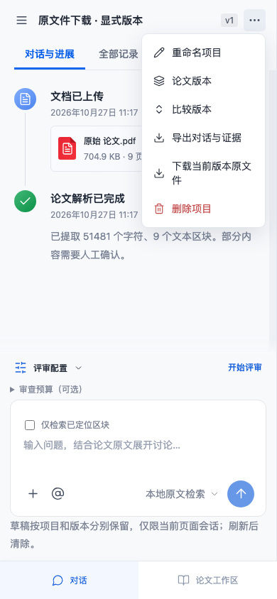

# 当前版本原文件下载

项目右上“项目操作→下载当前版本原文件”取回当前选中的PDF或DOCX。先在版本菜单选中需要的版本；按钮读取该版本的原文件名和明确版本URL，不因另有活动版本而回退。文献库打开文档预览后，“下载原始文件”取回预览本身的版本。无版本或演示版本没有可下载原材料。

文件是服务端已有的上传字节，保留PDF/DOCX格式、中文及空格文件名；不是从解析文字、截图或报告重建。原始文件保存与解析、问答、报告分别管理，下载不修改它们。与旧冻结报告复核时，请核对所选版本及文件SHA；这个按钮不会自动认证报告/原材料关系或生成包含全部附件的复核包。

## 接口与权限

复用GET /api/projects/:id/versions/:versionId/file，只有显式download=1令Content-Disposition变为attachment，UTF-8文件名及MIME继续沿用。默认与其他参数仍inline，保留PDF.js内嵌预览。授权工作空间与明确版本在返回文件前检查，不存在/无权项目或错误版本不能回退到活动材料。

链接为同源请求，沿用当前匿名工作空间Cookie，不创建公开分享链接，不绕过登录/空间隔离。浏览器决定下载目录；前端无需先读完整文件到Blob。没有增加持久化字段、模型调用、上传限制、复制到其他服务或新的文件内容。

## 验证与真实边界

4359b81先登记一项API与两项浏览器控制。基线分别因inline而非attachment、缺工作台按钮及缺预览链接失败，不能据此称原文件或预览损坏。

API在真实临时服务中上传两个合成PDF/DOCX版本，核对响应类型、原中文空格名称、所有下载字节和各版本SHA；新版活动时明确旧ID仍返回旧字节，默认及download=true仍inline。不同工作空间和不存在版本404，下载前后整个项目不变。

浏览器实际上传Du等2014的未修改原PDF与合成修订DOCX，下载两个选定版本、中文文件名、390px手机及刷新，比较实际下载文件的全部字节；文献库原PDF下载也与原文件/已存SHA一致，另一浏览器工作空间不能读取该链接，所有保存版本保持。许可与原PDF来源见third-pdf.md和fixtures署名说明；合成DOCX不是研究数据。

目标API1项与组合浏览器5项通过，完整构建273Node/92浏览器通过。新增1Node/2浏览器，外部模型请求0。

目标过程中保留两轮失败：新流程手机切回对话才可使用聊天区菜单；既有宽度测试改为同帧读取证据框和画布矩形，原容差不改。该旧测试又发生重复打开项目后POST200但界面无来源，改为等待已初始化项目，不重复请求；未修改PdfReader或openProject，不将其宣称为已修复的产品并发缺陷。重复同项目GET与发送的接受顺序仍需独立受控复现，已记入持续账本。

有限浏览器/字节验证不证明全部浏览器下载行为、原材料许可真实性、作者身份、专业复核或科学结论正确。用户清除匿名空间Cookie后能否恢复材料仍受原有工作空间访问限制，下载入口不新增恢复机制。
