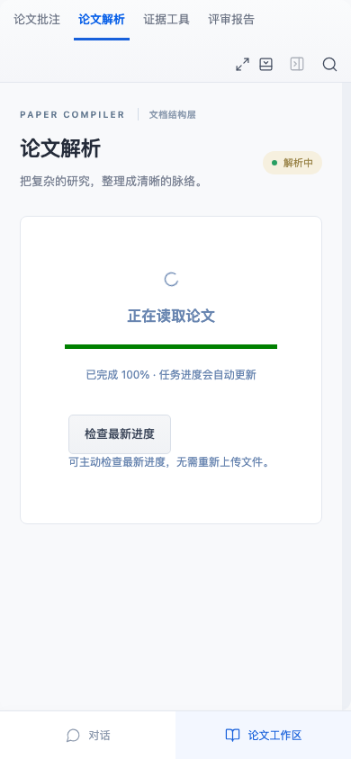

# 主动检查解析进度

上传后在“论文解析”页看到“正在读取论文”时，可点击“检查最新进度”。它只检查服务器当前状态，无需重新上传；即使已有后台状态读取仍在等待，也能主动检查。正常自动更新继续保留。

检查期间按钮显示“正在检查…”并禁用重复点击。服务器仍在解析时明确提示“服务器仍在解析”，不会伪装成完成。读取超过15秒会提示超时并允许再次手动检查；取消的只是这次状态读取，后台解析可继续。连接失败或返回材料身份不符会报错，不能作为成功。

切换项目、版本或离开解析中界面时，旧手动读取中止并清理定时器。接受结果前核对当前项目对象、选中版本、导航序号、设置修订及进行中的写入；后续已接受的新结果不会被更早的读回覆盖。它不会恢复旧阅读位置、选择旧报告、重新上传文件、启动解析、调用模型或生成报告。

## 实际控制与边界

v48追踪只确认上传被接受、界面解析中，以及一条状态GET没有完整响应；不能确定当时的解析耗时、浏览器调度或网络阶段。本入口覆盖一种可控的恢复场景，不等于旧偶发根因已经修复，也不保证加快解析。服务器实际未完成时，应继续等待或稍后检查；离线不能产生真实完成状态。

初始3b89d68登记2项控制，5973b9a在实现前细分为3项，基线均因没有此入口失败。9e24654实现后再补充2项响应/版本边界控制；这2项不是事前登记。目标8浏览器通过后仅移动手机截图时机并整理格式，最终完整构建286Node/108浏览器通过；新增5浏览器、无新Node。外部模型请求0。

测试通过真实API/Worker完成原DOCX上传，服务端保存的状态、原文、解析和初始报告都是真实结果；仅初次浏览器显示人为设置为解析中，延迟由浏览器路由控制。它们验证软件时序，不是历史问题的精确复现或专家评价：

- 扣住自动GET，主动GET可取得完成状态；随后释放旧解析中响应不回退。主动操作只发送GET，服务端完整版本不变。
- 手动GET超时后按钮可重试，新检查能取得完成状态；没有重新上传或重解析。
- 检查中离开项目或同项目v1切v2，迟到响应不改变新项目/选中版本，完整原版本保持。
- 503、外来项目身份明确拒绝且可重试；仍在解析时明确提示未完成，最终正常读回成功。
- 手机界面无横向溢出，完成后刷新可显示已保存解析；既有后台轮询3项控制保持通过。

旧技术PDF保留v45历史版本，本轮行为、计数、实现指纹与验证范围见本说明、parse-status-recovery-validation.json及交付核对。旧材料、署名和历史证明保持原样。
