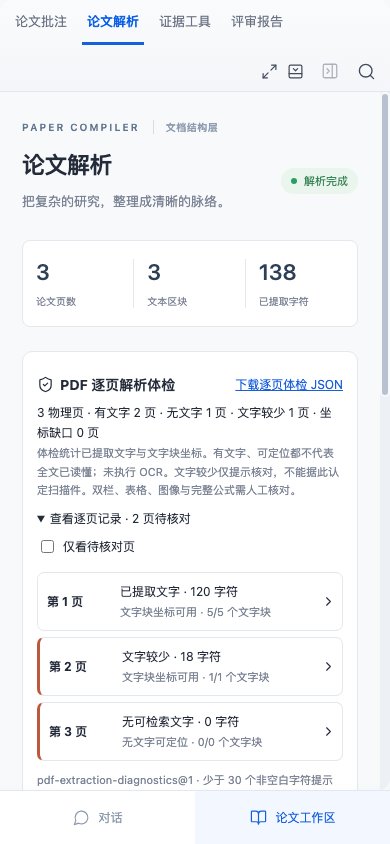

# PDF 逐页解析体检

`pdf-extraction-diagnostics@1` 保存每个物理页已提取字符、非空白 UTF-16 字符、非空白文字块及其可见坐标数量。它统计解析范围，不评价论文质量、研究结论或全文理解程度。解析文字、PDF.js 返回顺序、`pdf-text-map@1` 偏移与位置框均保持原样。

## 实际使用

上传含文本层的 PDF 后，在“论文解析”查看有文字、无文字、文字较少与坐标缺口的页数。展开逐页记录，可只看待核对页；点击页号返回物理原页，清除之前的引文、视觉区域和搜索高亮，不生成新的证据锚点。文档库预览也显示同一体检。

“下载逐页体检 JSON”保存文件 SHA-256、项目、版本、解析 ID、解析器、体检版本、全部页级计数及限制。下载要求当前工作空间与明确版本，不能因错误版本 ID 回退到活动版本；不包含论文全文、问答、模型配置或密钥。

新结构报告和新科学评审报告复制生成时的体检。报告页面显示冻结内容；解析身份不同不能跳转当前原文。Markdown、DOCX、PDF 导出都有独立体检附录，即使自定义模板省略覆盖范围也保留。后来重新解析或修改数据不会改写旧报告。

科学评审请求收到汇总、最多前 40 个待核对页及明确的遗漏数量；报告和 JSON 保存全部页。体检计数不改变科学评分或将材料缺口转换为学术缺陷。

## 判定边界

- 无文字：提取文本中没有非空白字符。可能是空页、图像、矢量图或缺少文字层，不能单凭该状态认定扫描件。
- 文字较少：1–29 个非空白 UTF-16 字符，仅触发人工核对。标题、封面等短页也会提示；emoji 等字符在 UTF-16 中可能占两个单位。
- 文字块坐标可用：偏移映射完整、非空白文字块均有有效可见矩形。它不证明阅读顺序正确或图表含义已理解，也不是字形精度指标。
- 部分／全部缺坐标：有效文字映射仍存在，但部分／全部非空白文字块没有可见矩形。只跳页的既有引文规则不变。
- 偏移映射异常：文字块起止、原文归属或覆盖不一致，不计为坐标可用。未记录：旧／未知文字映射不能猜测坐标数量。

体检不执行 OCR，不重建双栏阅读顺序、PDF 表格关系、跨页表格、图像或完整公式。500 页、单页 50000 文字块和 1000000 字符的原有处理上限仍明确失败，不截断后冒称完成。旧解析没有体检时显示“未记录”，不自动补造；需要新解析时在新项目上传同一原文件，避免原项目 SHA-256 去重。

## 验证与材料

12 项新 Node 控制检查空白／空格页、30 字符阈值、UTF-16、部分和全部缺坐标、空文字块分母、偏移损坏、未记录数据、物理页顺序和原有容量上限、不可变原文、字段清单与冻结报告、模型 40 页上下文上限。另新增 API 空间／版本隔离和受控评审冻结检查。材料由开发者编写，属于工程回归。

两个新浏览器流程实际上传三页手工 PDF：第1页有文字，第2页18字符，第3页只有矢量色块。验证手机刷新、逐页过滤、JSON 实际下载、空文字页不残留证据高亮、报告 Markdown 附录，以及旧解析拒绝导出。该矢量页不是实际扫描论文。手机截图见下方。

许可明确的 Beule 与 Karlovsky（2021）20 页出版商原始 PDF 保持 SHA-256 `f73ebc96d88181c3c1b014a0e89585792c9bd7e7fe90dfafd3de6e735e01ac92`。改动前后全部解析文本的指纹相同：`4d1eaf43c610435d17c6cf5be4b9b48842d2002705f7e7f82fd883548fc2f7f0`。同三题、21 条来源及摘要的逐字位置与坐标结果不变。体检实际记录20页有文字、1496个非空白文字块坐标可用，无阈值提示；这不证明双栏、表格、图像和公式已完整解析。完整记录见 [原始 PDF 检查](pdf-validation-results.md)。没有外部模型调用或专家标注，不称为专家准确率。
