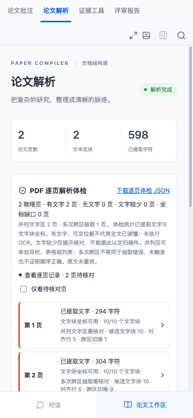

# PDF 并列文字区提示

逐页体检新增有限的并列文字区和多次跨区抽取提示，帮助用户选择需要核对的原页。它使用已验证的文字块矩形，不改变 PDF.js 原文顺序、UTF-16 偏移、引文或坐标；不重建双栏、表格或跨页关系，也不改变科学评分。

## 操作与保存身份

新上传 PDF 的 `pdf-extraction-diagnostics@2` 每页包含 `pdf-parallel-regions@1`。在“论文解析 → PDF 逐页解析体检”展开并筛选待核对页，可查看候选文字块、对齐行和跨区切换次数。点击页号返回物理原页并清除旧高亮，手机刷新后显示同一记录。

JSON 沿用工作空间、版本、源文件 SHA-256 和解析 ID 的约束，只导出统计字段。结构与科学报告、三种报告导出冻结同一记录；模型请求最多获得前40个待核对页及遗漏数量。提示不能充当原文证据或自动扣分。

历史 `pdf-extraction-diagnostics@1` 的字段、统计、限制和报告保持不变，界面明确显示“历史体检未记录布局提示”。更旧解析没有体检时仍拒绝导出。需要新记录时在新项目重新上传原文件。

## 固定阈值与限制

只有完整且可定位的文字映射参与检查；坐标不全、偏移异常或未知映射记为“无法检查”，计数为 null，不能当作零风险。无文字页计数为0。

候选块至少含12个非空白UTF-16字符；宽度为页宽0.10–0.43，高度大于0且不超过0.035，位于纵向0.08–0.92范围。左区块右边界不超过0.49，右区块左边界至少0.51。左右区各至少4个独立行、纵向跨度各至少0.08，且至少3行在0.012页高容差内配对，才提示并列区。按原始候选块顺序忽略中部块后，左右区切换至少3次时提示多次跨区抽取。

宽标题、短标签、窄单元格、页脚、竖排和未分区中部块不能直接形成并列区。这只覆盖有限水平几何；表格和列表也可能触发，多次切换不等于错误，未触发也不证明顺序正确。没有重排原文、OCR或语义表格理解。

## 固定控制与实际结果

实现前真实提交 `b9ac6da` 登记16个开发者几何控制、独立构造器和评测脚本。材料 SHA-256 为 `bad54a80b74ad9646b6ee8979618c08f5a7e3421ff2de3db0bf368b0d94c4858`，预期未修改。旧实现16例均未记录布局；新增实现16/16状态与待核对条件通过，源字符串、偏移和矩形均未改变。[改动前完整结果](pdf-layout-before.md)与[当前完整结果](pdf-layout-results.md)保留实现指纹。这是开发控制，不是独立保留集或专家准确率。

六项新增Node测试检查固定控制、畸形字段拒绝、字段清单与深复制、实际20页v1体检不变、100页提示的40页模型上限与报告冻结，以及生产Worker解析两页独立手写PDF。两页各10个有坐标文字块：按栏抽取切换1次，逐行左右交替切换9次，逐字引文与右区坐标有效。

两项新增浏览器流程实际上传该两页控制，验证搜索引文、筛选、跳页清除旧框、390px刷新、真实JSON下载和Markdown附录；另将同一保存记录转换为经验证的v1字段做兼容回放，原报告未被改写。该回放是受控记录，不冒称实际用户历史。完整 `npm run check` 为构建、218项Node和41项浏览器全部通过。

同一 Beule / Karlovsky（2021）20页原始CC BY 4.0 PDF的源文件与解析文本指纹、三个问题及全部21条引文和摘要记录保持一致；原有20页字符和坐标计数逐字段相同。新提示来自第4页一个多次跨区抽取区，实际原页可见 Table 1，不称为双栏错误。其余19页未触发只表示未满足阈值。详见[原文件结果](pdf-validation-results.md)与[一致性核对](pdf-layout-source-invariance.json)。原始DOCX36单元格、三题10切片，以及30例评审工程边界按原预期复跑通过，零外部模型调用。

复现：`npm run evaluate:pdf-layout -- --output ./test-results/pdf-layout`。结果保存全部正负控制、原文不变状态及材料和代码哈希。后续优先登记跨页表格与换行控制；专家评价仍需真实外部条件。
