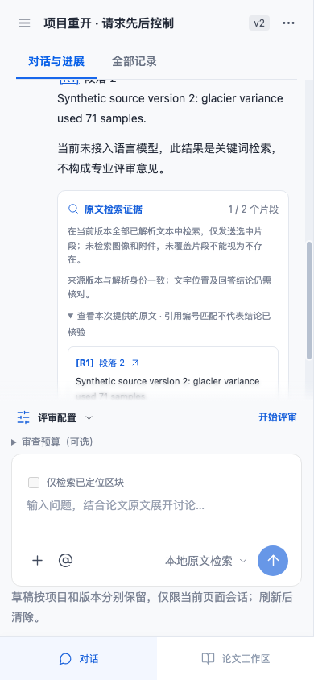

# 同项目重开与新结果保留

点击侧栏当前项目时，浏览器会重新读取项目。若网络较慢，而问答或报告保存先完成，以前迟到的读取可能把刚显示的回答或报告覆盖成旧状态。两个受控流程中，服务端保存记录始终存在，问题发生在浏览器接受旧快照之后。

现在当前项目在等待期间已接受另一个项目对象时，忽略这次旧读取，也不恢复旧视图或清空新报告选择。正常重新读取仍可取得服务端最新内容。明确点击另一个项目依旧完成导航；选中另一论文版本后，旧读取也不能把版本切回。

## 复现与修复边界

测试实际创建项目、上传两版合成DOCX并等待解析；随后只暂缓一个真实GET响应。响应内容通过route.fetch在新结果之前取得，原样返回，不伪造缺失数据，也不修改服务端。等待真实问答完成或工具报告保存之后释放旧响应，比较界面与全部保存版本。

登记提交e011269的初始准备假设有误：上传解析已生成事件和初始报告。56b567c独立纠正为只比较assistant和新报告ID。修正后的旧生产代码稳定暴露两条路径：旧响应后可见回答由1变0，新保存的第二份报告选择消失，后台版本保持。另外3项正常读取、跨项目及版本控制已通过。准备失败与产品基线分别保留，不能互换使用。

修复只在openProject记录起始project对象。原有最新导航序号校验通过后，如果打开的正是起始当前项目，且当前对象已被接受的新快照替换，则提前返回；避免旧数据替换与restoreView重置。打开不同目标项目不受此对象条件阻挡，未变当前项目也继续接受读取。服务器、模型、数据库和历史报告不改写。

## 验证

- 新回答先完成、旧GET后到：手机390px仍见回答，刷新后保持，保存版本逐项相同。
- 新报告先保存、旧GET后到：保留新报告选择，Markdown导出可用，原有及新报告均留存。
- 当前项目未被新结果替换：重新读取可显示服务端更新的标题。
- 明确进入另一个项目：原项目在等待期间接受回答，目标项目仍可打开，返回原项目仍见回答。
- 明确切换v1：晚到的项目读取不撤销新版本选择，存储记录保持。

目标组合12项浏览器通过；完整生产构建、273项Node与97项浏览器通过，比上一轮新增5项浏览器。旧后台轮询、原文件下载和PDF宽度流程也参与目标检查，测试断言未放宽。

这是对明确接受顺序的有限回归：不承诺全部网络时序、跨标签页实时同步、所有原位设置编辑和所有项目写入竞争均已解决；对象原位修改不等于接受新的对象。既有后台轮询使用自己的对象/导航保护，本轮不改变其超时或重试。合成DOCX及离线问答只验证软件行为，不构成独立专家评价或科学准确率。
