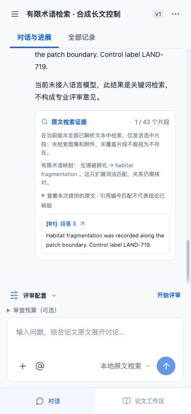

# 有限术语检索与可追溯映射

`bm25-lexical@3` 在现有词法检索中加入 `ecology-term-map@1`，目前只登记两条完整术语。问答证据卡片显示采用了哪条映射，刷新、短追问和 Markdown/JSON 导出保留各条回答自己的映射与版本。历史消息不重写。

| 中文       | 英文                  | 核对来源（2026-10-08）                                                                               |
| ---------- | --------------------- | ---------------------------------------------------------------------------------------------------- |
| 光合作用   | photosynthesis        | [FAO Terminology Portal 双语条目](https://faoterm.fao.org/viewEntry.html?entryId=181045&language=en) |
| 生境破碎化 | habitat fragmentation | [《生物多样性》双语术语表](https://www.biodiversity-science.net/CN/figure/showFigure.do?fid=86577)   |

源码 `server/retrieval-terms.js` 保存显式词表、来源与核对日期，只使用短语名称，没有复制文献正文或完整定义。这两条映射由开发者选定，用来处理既有失败，不属于独立盲测发现，也不代表通用生态学词汇覆盖。

## 匹配与位置政策

查询中识别完整术语后，用同一概念标识匹配两种语言。英文匹配要求完整词边界；`photosynthesist` 不按 `photosynthesis` 匹配。英文短语允许空格、换行和连字符，中文术语允许字间排版空白；区块标题与正文分别识别，不把标题里的 Habitat 和正文里的 fragmentation 拼成术语。

已识别短语不会再用其中的孤立词回退匹配。因此只问“生境破碎化”时，包含 DNA fragmentation、单独 habitat 或中文分散词块的控制材料不会因为术语映射被取回。查询里其他普通词仍按现有词法排序，可能带来额外结果；这不是语义相关性判定器。

检索使用 NFKC 和小写，证据仍保存原文连续切片。摘要位置把标准化字符索引映射回原文 UTF-16 偏移，保留全角、换行及组合字符。选中意见的优先级也遵循 `exact-occurrence@2`：明确偏移必须逐字匹配；缺少偏移的重复引文不能默认优先第一处。

这项改进只验证文字匹配。`Photosynthesis was not measured` 仍是有效词法来源，不能把命中解释为支持某个科学主张。`carbon assimilation` 等未登记近义表达不会自动映射；同义词、否定关系、隐含推理和图像内容仍需独立判断。

## 固定材料与实际结果

首先保持既有 18 个合成版本、38 例的文字、标签、分组和预设不变。其展开材料 SHA-256 始终为 `844a9e8e20e88a3fe739a0d4baf98d15d21dd5742fdef094ff373a40a3442d6e`。本轮改动前实际重跑 `@2` 为 36/38，改动后 `@3` 为 38/38；预设区块召回由 27/29 到 29/29，返回切片由 36/36 到 38/38 均逐字有效。原来的两个 exploratory 分组和历史缺口说明保留；[旧完整记录](retrieval-benchmark-v2-results.md)与[当前完整记录](retrieval-benchmark-results.md)分别保存。

实现前另写 **20 个合成版本、24 个固定控制**，材料及全部期望 SHA-256 为 `caaac785d44e13a7d8e301917154230a167d6d5f0123ca74c5a2c835a98f950f`，修复前后不变。它们覆盖双向映射、大小写、全角与换行、长文后部、两主题与短追问、同 ID 跨版本、预算上限、第二处引文，以及禁止返回的近似词区块。

| 同一新增控制集      | 改动前 @2 | 改动后 @3 |
| ------------------- | --------- | --------- |
| 通过用例            | 6/24      | 24/24     |
| 预设区块召回@8      | 1/14      | 14/14     |
| 错误拒取 / 意外匹配 | 12 / 6    | 0 / 0     |
| 无命中精确率        | 5/17      | 11/11     |
| 无命中召回率        | 5/11      | 11/11     |
| 返回原文切片有效    | 7/7       | 14/14     |

保存[改动前逐例结果](retrieval-terminology-before.md)、[改动后逐例结果](retrieval-terminology-results.md)及同名 JSON；全部失败进入分母。正向命中还会检查 `forbiddenElementIds`，返回禁止区块不能因同时取到正确区块而通过。当前报告包含实际实现 SHA-256；改动前报告按其实际生成字段保留，不补写当时没有登记的实现哈希。耗时是本机逐例一次测量，每份报告保留自己的 p50/p95，不是服务 SLA，不能据一次结果宣称性能提升。

这些是开发者编写、用于开发的固定合成控制。预期先于实现登记，但由同一开发者设计，不能称为独立保留集、专家准确率或通用语义能力。科学关系与领域专家评价仍按 [校准流程](calibration.md)另外实施。

## 复现与浏览器验证

```sh
npm run evaluate:retrieval -- --output test-results/retrieval
npm run evaluate:terminology -- --output test-results/terminology
node --test tests/retrieval-terminology.test.js
npx playwright test tests/e2e/retrieval-terminology.spec.js
```

浏览器控制从空空间上传真实 DOCX 文件，文件内容为自编英文文本；目标位于超过 24000 字符的背景之后。实际验证中文查询、原文定位、390px 刷新、追问继承、DNA 近似词排除和下载 JSON/Markdown 中的原文、映射与策略。该流程使用本地原文检索，没有运行商业模型或领域专家评审。


