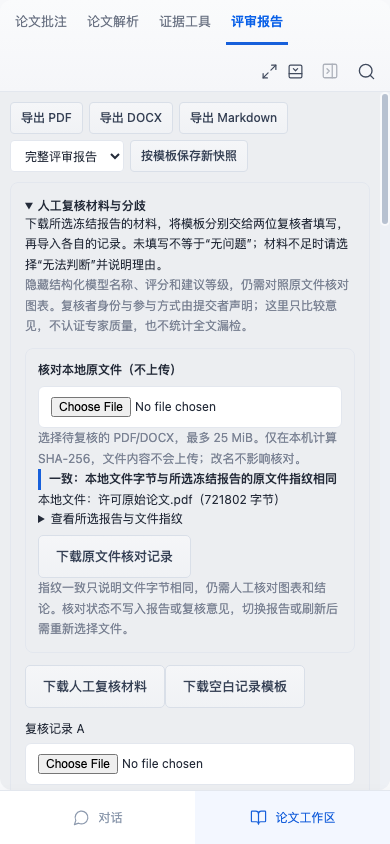

# 人工复核原文件本地核对

在“评审报告”选择要复核的冻结报告，展开“人工复核材料与分歧”，使用“核对本地原文件（不上传）”选择手头PDF/DOCX。系统对比的是所选报告绑定的原文件，不会回退到别的活动版本。旧报告缺少解析身份或材料身份不一致时，沿用服务器拒绝，显示无法核对。

文件最多25MiB且非空。浏览器先读取该报告的材料身份，之后通过Web Crypto对本机文件全部字节计算SHA-256；需要支持Web Crypto的HTTPS或本机页面。网络只取得既有报告材料，不发送本地文件内容、名称或摘要。无需将文件再次上传到项目；此功能也不解析本地PDF文字、图表或DOCX内容。

## 结果如何理解

- 一致：整个本地文件的SHA-256与所选冻结报告原文件摘要相同，改名不影响。
- 不一致：摘要不同，请先确认版本、是否重新保存/修改过文件，再继续复核。同名不能保证字节相同，哪怕只变1字节也会不同。
- 无法核对：文件为空或过大、报告身份被拒绝/无效、浏览器缺少摘要能力、读取或计算失败。此时不会保留之前的一致状态或核对记录下载。

可展开查看冻结报告ID及双方完整摘要。下载的“原文件核对记录”采用original-file-check@1，含报告/版本/解析/材料包指纹，本地文件名、字节数、SHA-256、实际浏览器时间和状态；不含文件字节或人工复核意见。记录是本地生成、可编辑的JSON，未签名，不会写入冻结报告或两份标注记录，也不自动影响比对结果。

同一文件可明确重选重试。选了新文件立即清除旧状态，后到的旧请求不能覆盖新文件结果。更换报告、版本或刷新会清空核对，必须针对新报告重新选择文件。文件仅用于本次计算，不建立浏览器文件句柄或持久化恢复。

## 验证与边界

24a2049先登记3项浏览器流程，旧界面因没有新输入控件全部失败。真实上传既有Du等2014原始PDF及合成修订DOCX；PDF来源/许可与指纹见third-pdf.md和fixtures署名记录。两个格式对应既有材料，不增加独立研究数量。

实际控制核对同名异字节、改名同字节、单字节改动、显式旧PDF版本、下载记录摘要/身份、手机390px与刷新；每次正常检查只允许evaluation GET且无请求体，全部保存版本保持。延迟真实metadata响应验证新文件优先及切换报告后废弃旧结果；空文件/超出限制、409、无效摘要和受控计算错误均不显示旧成功。目标7项浏览器与完整构建273Node/100浏览器通过，外部模型请求0。

原文件摘要一致只说明字节身份相同，不认证作者、材料许可、材料包签名、复核者独立性或专家质量；也不证明原文解析完整、引用支持关系或科学结论正确。仍应使用原文件人工查看图表、方法及上下文，并真实填写“无法判断”和理由。尚无真实独立专家漏检金标准或科学准确率数据。
