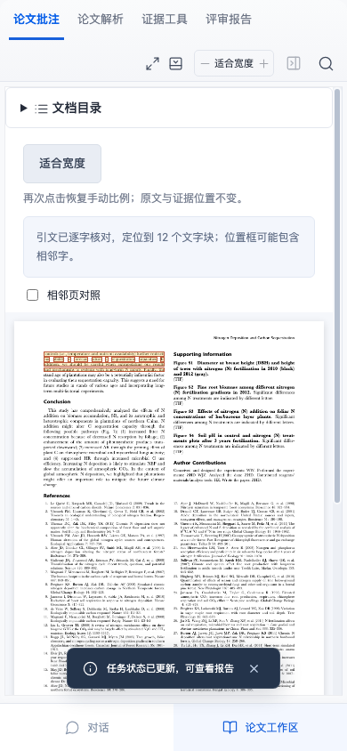

# 第三份原始PDF：保留限制性文字的证据定位

Du, Z., Wang, W., Zeng, W. & Zeng, H.（2014）, Nitrogen Deposition Enhances Carbon Sequestration by Plantations in Northern China. PLOS ONE 9(2): e87975，DOI [10.1371/journal.pone.0087975](https://doi.org/10.1371/journal.pone.0087975)。[出版商原文与版权](https://journals.plos.org/plosone/article?id=10.1371/journal.pone.0087975)、[原PDF](https://journals.plos.org/plosone/article/file?id=10.1371/journal.pone.0087975&type=printable)。©2014 Du等，2026-10-26核对版权行及链接为[CC BY4.0](https://creativecommons.org/licenses/by/4.0/)。原始署名、版权、图像与文件内容均保留；再分发请同时保留来源和tests/fixtures/published-pdf/README.md。

原文件du-2014.pdf共9物理页、721802字节，SHA-256为33ef06c62023175737a1e1454cf7b82977b2223eebaa7fbcb4296caaeb8ca815。文件未修改，也不是经过重排、OCR或替换图片的测试副本。

## 先登记再验证

生产检索前，独立pypdf提取并渲染原物理页1/2/4/8，核对署名与三个目标：第2页试验布局描述、第4页统计软件文字、第8页向长期输入情境外推的限制性文字。短语、问题、页号、原文件指纹与来源声明在du-2014-source.json固定，e1f4a23提交后才调用生产Worker和检索。没有根据返回结果调整查询或目标。

这是有限开发者来源定位控制：不评判该研究的试验设计、Duncan检验、机制解释或结论是否正确，不以定位到软件名称作为统计审查通过。第8页短语仍按原文切片保存，不改写为更强或更弱的结论。

```sh
npm run evaluate:pdf -- --manifest tests/fixtures/published-pdf/du-2014-source.json --output ./test-results/du-pdf-current
```

现有脚本无需修改即可选择新清单。实际published-pdf-validation@2记录的九项通过条件全部满足：3/3固定问题命中，3/3预期短语坐标可映射；24/24完整切片与摘要逐字有效，完整/摘要坐标也各24/24。9页全部文字块原偏移有效，无非空白文字块坐标遗漏。完整原始结果包含逐题返回页、真实偏移、切片指纹和体检，不输出整篇论文提取文本；见third-pdf-validation.json。

坐标只是文字块近似范围，不是字形测量。可检索文字和可定位不说明双栏顺序、表格关系、公式和图像已被理解；不调用模型，也不评估科学支持关系。

## 实际产品链路

一项新增浏览器控制在空工作空间创建项目并实际上传未修改PDF，核对文件SHA及9页。使用清单登记的第三题，在实际保存的回答来源中找到第8页短语，核对原文切片、位置映射及来源编号；390px手机启用适合宽度后，原页、证据框和原始文字块偏移保持。刷新再定位后整个版本对象与保存值一致，包括解析、消息和报告。

没有写入预置报告或修改SQLite制造命中。来源由实际服务检索并保存，模型未启用；界面默认空空间的行为不变，新增材料仅存测试目录，不自动注入用户文献库。



目标8项Node与1项浏览器通过，完整生产构建、272项Node与87项浏览器通过。本轮新增1Node/1浏览器，既有清单与生产实现不改，目标无需制造失败再修复。

## 样本与来源边界

此论文已属于三篇XML案例。三份原PDF现在分别对应这三篇论文，不是新增第四个独立研究，也不是随机样本、独立保留集或专家盲标。固定目标、软件通过数和多格式重复验证均不能作为专家准确率、全文召回或通用PDF成功率。

独立专家、许可清楚的留出材料和完整漏检清单仍缺。原两份PDF、原有预期和历史@1/@2记录保持原字节，新结果单独保存，避免把本轮计数覆盖历史分母。
