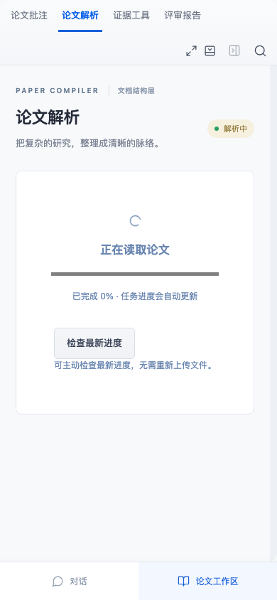

# 上传完成与列表读取分离（候选）

状态更新（v52）：候选代码未改动，新启动的一次完整检查通过286Node/110浏览器，详见[复验记录](upload-list-recheck.md)。下文v51三轮失败是当时的历史结果，完整保留，不据此声称偶发根因已修复。

上传请求结束后，页面立即解除“上传中”状态。后续项目列表读取延迟时，解析页的“检查最新进度”继续可用，不必因列表未返回而重新上传。如果列表读取失败，会明确提示“文件已上传，项目列表暂未刷新”，当前解析保留。

上传请求本身失败时，仍显示原上传错误、解除忙碌并允许同文件重试；没有成功上传就不追加列表跟进或虚构新版本。本次列表跟进完成后不再清除上传忙碌状态，避免旧读取回调影响之后开始的上传。列表读取仍可等待，本修复不为上传POST增加超时或重传策略。

## 复现与实际检查

旧uploadFile在真实POST202后等待refreshList，再清除uploading。191a422先登记两项浏览器控制，旧实现1失败/1通过：真实Worker已完成解析，后续列表GET被扣住时，进度检查按钮仍禁用；原有上传503后重试已经可用。

d96468c把忙碌释放移到上传请求结束处，仅在成功后继续列表跟进。目标检查另外补充列表最终503场景：软件时钟暂停自动轮询，只扣住浏览器列表GET，不改上传结果或服务器保存状态。手机检查按钮可用，取得已保存解析，上传次数为1，服务端完整版本不变；列表最终失败不回退解析，也不误报上传失败。另一个控制首次POST503、同文件再试正常，最后只有1个真实版本。

首轮完整浏览器109通过/1项旧术语流程等待解析超时；日志和追踪保留，原条件复验通过，未改代码/测试/超时，不能据此认为历史根因已修复。第二轮另有旧对话创建标题等待超时（109通过/1失败），独立原条件2流程复验通过，日志/追踪另保留；无代码或超时修改，不把两次失败混同。随后目标7浏览器及最终生产构建与286Node通过；三次完整浏览器均109通过/1失败，第三次为旧PDF流程尚未上传前等待新建项目按钮超时，不能记为全量通过。此次仅发布私有候选分支，不合入main；新增2浏览器，无新Node或外部模型请求。现有解析恢复5流程继续通过，手机截图已查看。生产改动只有App上传控制逻辑，不改解析器、科学评价或历史报告。

## 范围

这确认并修复了“上传忙碌被后续列表GET拖住”的独立路径。v48旧追踪中的列表GET已有成功记录，不能据此把本轮问题称为其历史根因；旧浏览器调度/Worker/网络等待仍未确定。没有解决所有网络中断、原上传POST无限等待或跨客户端同时修改的问题，也没有以软件检查推断专家准确率。

当前交付计数见验证JSON与回执；技术PDF保留v45历史版本，原材料、许可、旧截图及验证记录保持。
